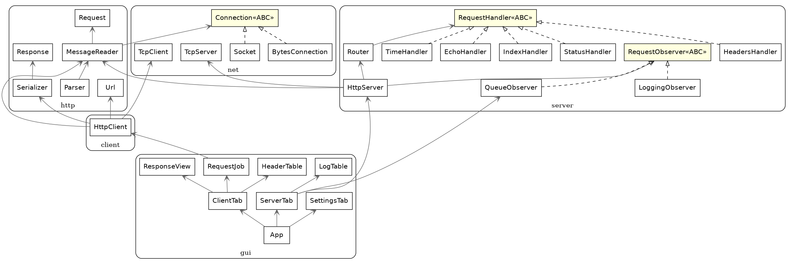

# Отчёт: HTTP-клиент и сервер с GUI

## 1. Диаграмма классов

Исходник PlantUML: `class_diagram.puml`. Три интерфейса (ABC): `Connection`, `RequestHandler`,
`RequestObserver`. Классов — более 25.

## 2. Скриншоты

| № | Файл | Что показывает |
|---|------|----------------|
| S1 | `screenshots/S1_client_get.png` | GET `/time`: URL, метод, статус 200, заголовки, JSON с подсветкой |
| S2 | `screenshots/S2_client_post_echo.png` | POST `/echo`: тело запроса и эхо в ответе |
| S3 | `screenshots/S3_client_error_invalid_url.png`, `S3b_…connection_refused.png` | ошибки показаны в области ответа |
| S4 | `screenshots/S4_server_running.png` | зелёный индикатор, порт 8080 |
| S5–S8 | `evidence/S5-S8_curl.txt` | `curl -v` на `/`, `/echo`, `/status/418`, `/nonexistent` |
| S9 | `screenshots/S9_server_log.png` | лог сервера (метод, путь, статус, мс) |
| S10 | `evidence/S10_pytest.txt` | `pytest tests/ -v`: 107 passed |
| S11 | `evidence/S11_flake8.txt` | flake8 без ошибок, pylint 10.00/10 |
| S12 | `evidence/S12_parallel.txt` | 100 параллельных запросов — все 200 |
| S13 | `class_diagram.png` | диаграмма классов |

Примечание: S1 по ТЗ — `http://example.com`; в среде, где собирались скриншоты, нет доступа в
интернет, поэтому GET выполнен к локальному серверу. На своей машине повторите S1 с example.com
(клиент проверен на локальном сервере и на «сыром» сервере с chunked-ответом).
Скриншоты GUI снимаются скриптом `tools/make_screenshots.py` (Linux + Xvfb).

## 3. Соответствие тестов из ТЗ

* U1–U3 — `tests/test_url.py`; U4–U10 — `tests/test_parser.py`, `tests/test_serializer.py`.
* I1–I10 — `tests/test_integration.py` (`test_i1_…` … `test_i10_…`), плюс проверки редиректов,
  500 при падении обработчика, перезапуска на том же порту, занятого порта, слежения за утечками.
* G1–G6 — вручную; автоматизированный дымовой тест GUI — `tests/test_gui_smoke.py`.
* Всего: 107 тестов, все проходят; `python -X dev -m pytest` — без предупреждений о потоках.

## 4. Анализ

**Что было сложным.**
1. *Остановка сервера.* `accept()` блокирует поток, `close()` из другого потока его не будит.
   Решение: таймаут на `accept` + флаг + `shutdown()` активных соединений.
2. *Потоки и tkinter.* Tk-вызовы допустимы только из главного потока: сеть работает в потоках,
   а результаты возвращаются через `queue.Queue` + `after`. Дымовой тест нашёл два реальных бага:
   атрибут `_name` в виджете затирал внутренний атрибут tkinter, а `gc` в чужом потоке пытался
   финализировать `StringVar` (лечится `gc.collect()` в главном потоке).
3. *Фрагментация TCP.* `recv` возвращает сколько угодно байт, поэтому `MessageReader` накапливает
   буфер, а границы сообщений определяет по протоколу, а не по границам `recv`.

**Что можно улучшить.** Пул потоков вместо потока на соединение; поддержка `HEAD`/`405`;
HTTP/1.1 pipelining и `Expect: 100-continue`; сжатие (`gzip`); TLS на стороне сервера.
